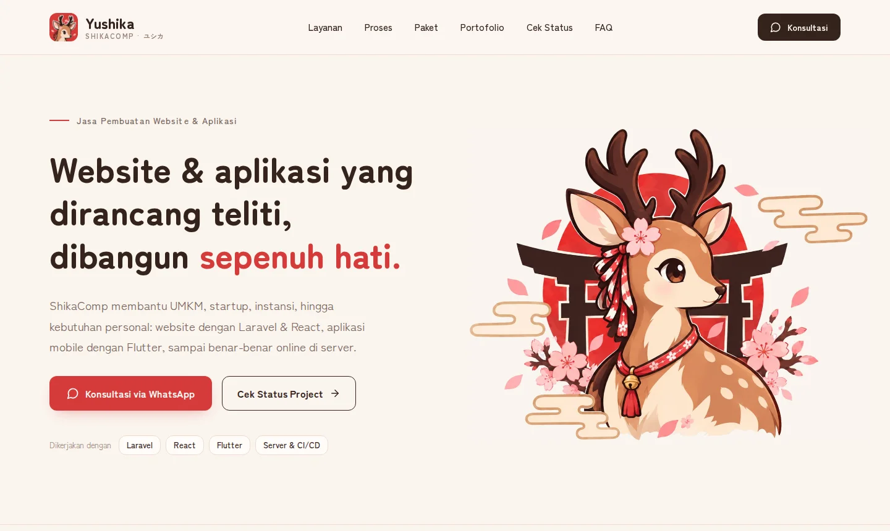
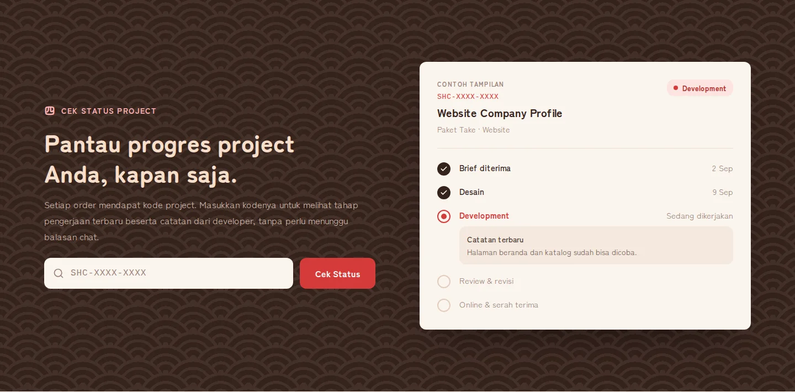
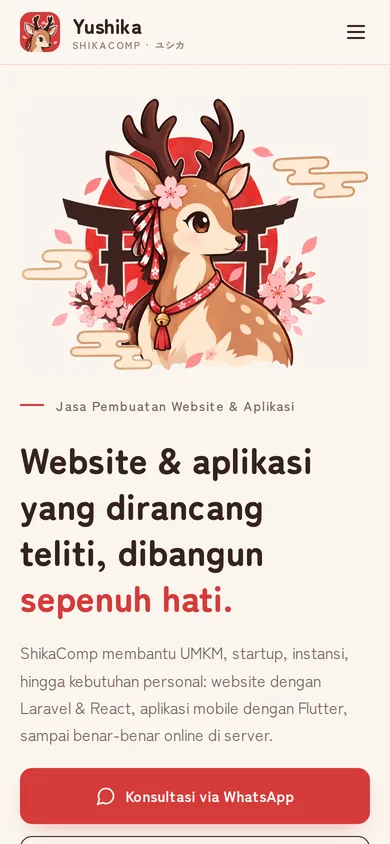
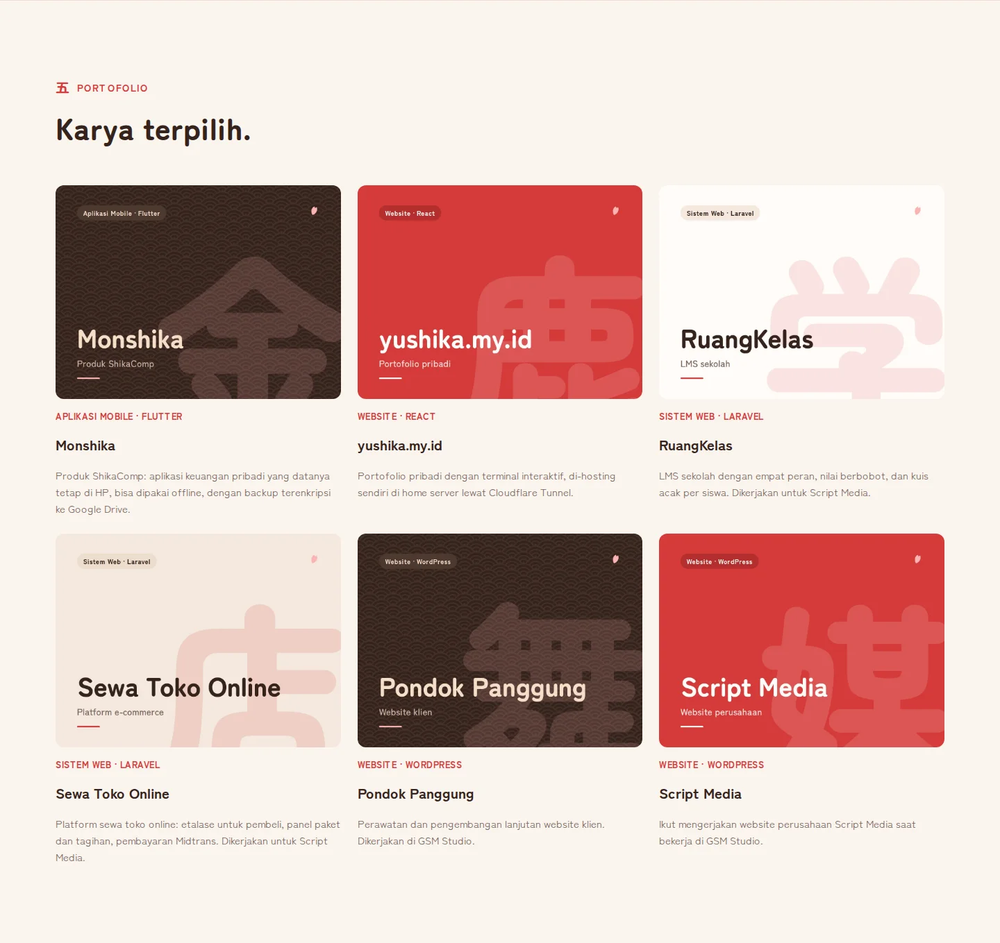

<p align="center">
  
</p>

<p align="center">
  <b>鹿 ShikaComp</b> · Website, mobile app, and server services by Yushika<br>
  <sub>丁寧に、つくる。 · built carefully, with heart</sub>
</p>

<p align="center">
  <a href="https://yushika.my.id"></a>
  
  
  
  
</p>

---

## 一 · What it is

The website for **ShikaComp**, my small studio for websites (Laravel + React), mobile apps (Flutter), and server setup and maintenance. It has two sides:

- **Public site:** services, a four-step process, packages (梅 Ume, 竹 Take, 松 Matsu), a portfolio, FAQ, and WhatsApp buttons with the message already filled in.
- **Project tracker:** every order gets a code like `SHC-7KQ2-M9XA`. Clients enter it on the site to see which stage their project is in and the latest note from me, without waiting for a chat reply.

<p align="center">
  
</p>

## 二 · Features

| | |
| --- | --- |
| 🦌 **Landing page** | Hero, services, process (聞く · 設計 · 作る · 届ける), packages, portfolio, about, FAQ, and a call to action |
| 🔎 **Project status lookup** | Public `/cek-status` page by project code, throttled to 30 requests a minute so codes can't be guessed |
| 🗂️ **Admin panel** | Manage service categories, packages, and projects; post status updates that build each project's timeline |
| 💳 **Payment status** | Unpaid, down payment, or paid, tracked per project |
| 🔐 **Accounts** | Laravel Fortify login with two-factor authentication and passkeys |
| 💬 **WhatsApp ordering** | Each package button opens WhatsApp with a message naming the package |

<table>
  <tr>
    <td width="68%"></td>
    <td width="32%"></td>
  </tr>
  <tr>
    <td align="center"><sub>Cek Status Project: clients follow their project by code</sub></td>
    <td align="center"><sub>Phone layout</sub></td>
  </tr>
</table>

<p align="center">
  
</p>

## 三 · Stack

- **Backend:** PHP 8.3+, Laravel 13, Laravel Fortify, Wayfinder
- **Frontend:** Inertia 3, React 19, TypeScript, Tailwind CSS 4, Radix UI
- **Quality:** Pest, Larastan, Pint, and `vp check` (lint, format, types), all run by `composer ci:check`

## 四 · Run it locally

```bash
composer setup   # install, .env, app key, migrate, npm install, build
composer dev     # server, queue, and Vite together
```

Seed the Ume / Take / Matsu packages with `php artisan db:seed --class=ProductSeeder`, then set prices from the admin panel.

Contact details shown on the site come from `.env`:

```dotenv
SHIKACOMP_WHATSAPP=          # 08xx or 628xx
SHIKACOMP_EMAIL=
SHIKACOMP_INSTAGRAM=
SHIKACOMP_BUSINESS_HOURS=    # e.g. "Senin–Jumat, 09.00–17.00 WIB"
```

Anything left empty is simply hidden on the site.

## 五 · Editing content

| Change | File |
| --- | --- |
| Portfolio items | `resources/js/data/portfolio.ts` (covers in `public/images/portfolio/`) |
| FAQ | `resources/js/data/faq.ts` (answers with a `[BRACKETED]` part stay hidden until filled in) |
| Packages and prices | Admin panel → Products |

---

<p align="center">
  <br>
  <sub>© 2026 ShikaComp · <a href="https://yushika.my.id">Yushika</a> · 丁寧に、つくる。</sub>
</p>
